# Introdução

Este repositório documenta a atividade de **testes caixa cinza em uma API de autenticação**, utilizando o **Supabase** como serviço de autenticação, o **Postman Desktop** para execução das requisições e o **GitHub** para documentação.

- **Aluno:** Tiago José Redondo Burani
- **RA:** 252110
- **Repositório:** tiago-burani-252110

Estrutura do repositório:

```
/README.md
/postman/    -> coleção e environment exportados do Postman
/prints/     -> evidências (prints) de todas as etapas
/planilha/   -> planilha de registro dos testes
```

# Objetivo da Atividade

Compreender e aplicar testes de caixa cinza em APIs de autenticação, ou seja, testes em que o testador conhece parcialmente a estrutura do sistema (endpoint, headers, body JSON e respostas HTTP). Nesta atividade foram realizadas as seguintes ações:

- configuração de um ambiente de autenticação no Supabase;
- criação de um usuário de teste;
- configuração do Postman (Workspace e Environment);
- criação e execução de requisições HTTP de login;
- validação de status HTTP, respostas JSON, mensagens de erro e access token;
- documentação técnica de todo o processo.

# Configuração do Supabase

**Como o projeto foi criado:** Foi criado uma conta no Supabase, e um projeto chamado `tiago-burani-252110`, aguardei a criação e acessei o painel.

**Tipo de autenticação utilizada:** autenticação por **e-mail e senha** (provider *Email*), habilitada em *Authentication → Providers*.

**Como o usuário foi criado:** em *Authentication → Users → Add user → Create new user*, informando e-mail e senha.

**Objetivo da configuração:** ter um serviço de autenticação real e funcional para ser testado pelo Postman, com um usuário válido para o cenário de sucesso e a possibilidade de simular cenários de erro.

**Credenciais utilizadas nos testes:** Project URL e chave `anon/public` (obtidas em *Project Settings → API*). Por segurança, a chave não é exibida por completo neste documento.

### Evidências

| Evidência | Print |
|---|---|
| Projeto criado | 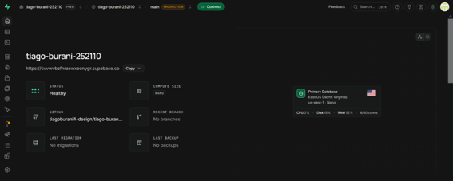 |
| Autenticação por e-mail habilitada | 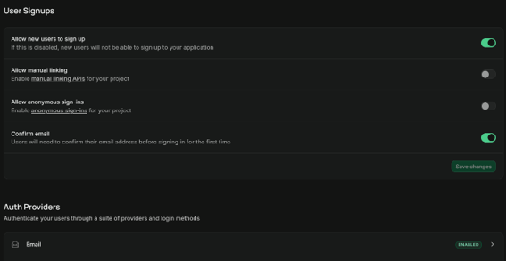 |
| Usuário criado | 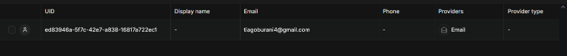 |
| Credenciais da API | 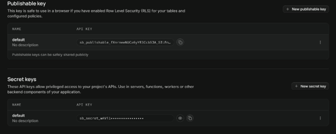 |

# Configuração do Postman

**Workspace:** foi criado um Workspace dedicado à atividade `Testes Caixa Cinza`, para manter as requisições organizadas.

**Environment:** foi criado o Environment `Supabase`, com as variáveis abaixo. Usar variáveis evita repetir valores em cada requisição e permite trocar de projeto ou de usuário alterando um único lugar.

| Variável | Descrição |
|---|---|
| `base_url` | URL da API do Supabase (Project URL) |
| `api_key` | Chave da API (anon/public) |
| `email` | E-mail do usuário criado para teste |
| `password` | Senha do usuário criado para teste |

**Como o Postman é utilizado:** as requisições referenciam as variáveis no formato `{{variavel}}`. Para cada cenário de teste, a requisição é executada e o status HTTP e o JSON de resposta são analisados.

### Evidências

| Evidência | Print |
|---|---|
| Workspace criado | 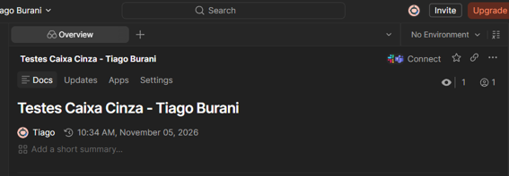 |
| Environment criado | 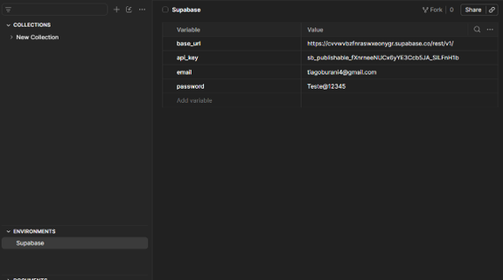 |
| Organização do Postman | 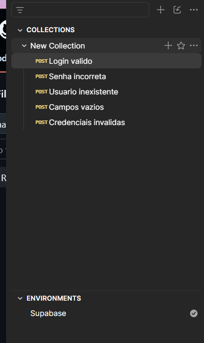 |

# Configuração das Requisições

- **Endpoint:** `{{base_url}}/auth/v1/token?grant_type=password`
- **Método HTTP:** `POST`
- **Finalidade:** autenticar um usuário com e-mail e senha. Se as credenciais forem válidas, o Supabase devolve um `access_token` (JWT); caso contrário, devolve um erro.

### Exemplo de Header

| Header | Valor |
|---|---|
| `apikey` | XXXXX |
| `Authorization` | Bearer XXXXX |
| `Content-Type` | application/json |

### Exemplo do Body JSON

```json
{
  "email": "usuario@email.com",
  "password": "123456"
}
```

No Postman, o body usa as variáveis do Environment: `"email": "{{email}}"` e `"password": "{{password}}"`.

### Evidências

| Evidência | Print |
|---|---|
| Headers | 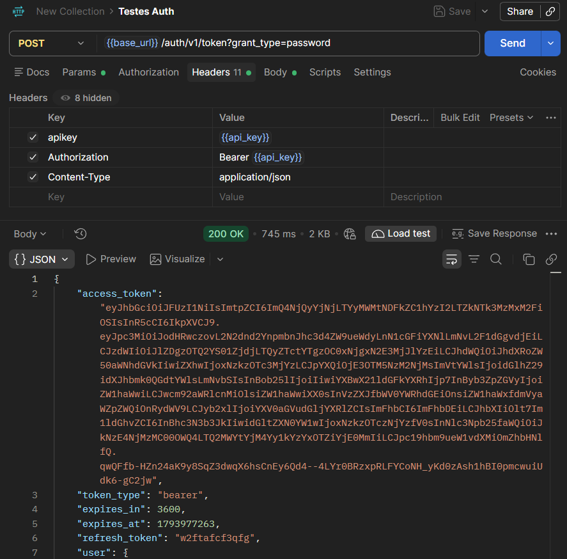 |
| Body JSON | 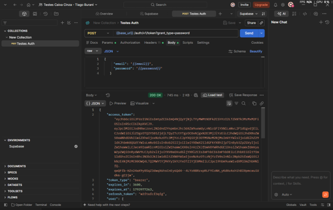 |
| Requisição criada no Postman |  |

# Execução dos Testes

Foram executados os cinco cenários obrigatórios, duplicando a requisição de login e alterando apenas o body.

| Cenário | Entrada Utilizada | Resultado Esperado | Resultado Obtido | Status |
|---|---|---|---|---|
| Login válido | E-mail e senha corretos | Status 200 + access token | Status 200 OK com `access_token`, `token_type: bearer` e `expires_in: 3600` | OK |
| Senha incorreta | E-mail correto + senha `senha123` | Status 400 + erro de autenticação | Status 400 com `Invalid login credentials` | OK |
| Usuário inexistente | `algumacoisa@teste.com` + senha válida | Status 400 + acesso negado | Status 400 com `Invalid login credentials` | OK |
| Campos vazios | `email: ""` e `password: ""` | Status 400 + erro de validação | Status 400 com `missing email or phone` | OK |
| Credenciais inválidas | `email: "abc"` e `password: "xyz"` | Status 400 + mensagem de erro | Status 400 `Invalid login credentials` | OK |

**Erros encontrados durante a execução:** Inicialmente no postman, tive os erros 401 e 400 por não ter colocado o header e body e ter tentado colocar POST, causando os dois erros que corrigi posteriormente.

### Evidências

| Cenário | Print |
|---|---|
| Login válido (status 200 e access token) |  |
| Senha incorreta | 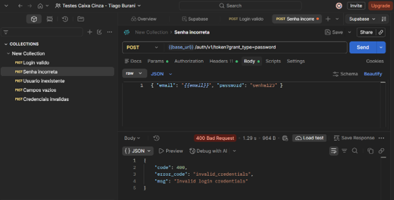 |
| Usuário inexistente | 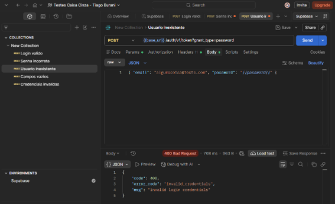 |
| Campos vazios | 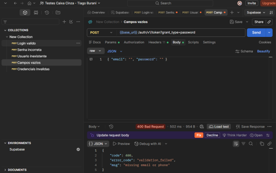 |
| Credenciais inválidas | 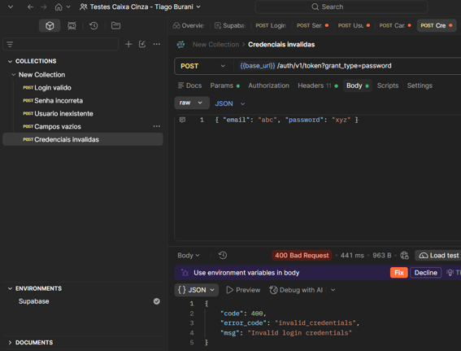 |

# Registro dos Testes

Os testes foram registrados em planilha (`/planilha/Registro_de_Testes.xlsx`) com as colunas: ID do teste, Cenário, Entrada, Resultado esperado, Resultado obtido, Status e Observações.

**Importância da documentação dos testes:** registrar entradas, resultados esperados e obtidos permite repetir os testes, comparar versões, comprovar o que foi validado e localizar falhas com rapidez.

**Falhas identificadas:** nenhum erro final, todos os testes de segurança foram bem-sucedidos. Erros de configuração (falta de header e body) foram corrigidos durante a execução do teste

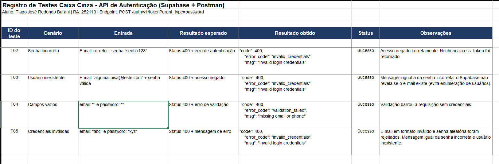

# Resultados Obtidos

- Foram executados **5 cenários**, todos com o comportamento esperado.
- O login válido retornou **status 200** e um **access token (JWT)** com validade de 3600 segundos.
- Os cenários inválidos retornaram **status 400** e **não** retornaram token.
- Senha incorreta, usuário inexistente e credenciais inválidas retornaram a **mesma mensagem**, o que evita revelar quais e-mails possuem cadastro.

# Conclusão

Todos os testes, de confirmação e de segurança, deram seus resultados esperados, sem nenhum grande contratempo. Os tokens de acesso foram cedidos para entradas bem-sucedidas. A única dificuldade pelo caminho foi a minha confusão em ter esquecido de configurar o Header e Body, que apresentaram os erros de falta de informações. mas tive sucesso posteriormente. Uma possível melhoria é a exigência de senhas fortes, autenticação de dois fatores e limitar tentativas de login.
A importância do teste de caixa cinza é analisar falhas graves de segurança e autenticação antes de chegar no usuário final.
